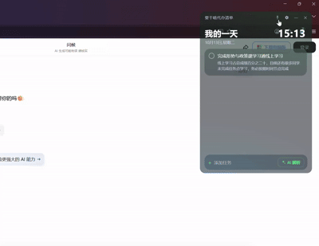
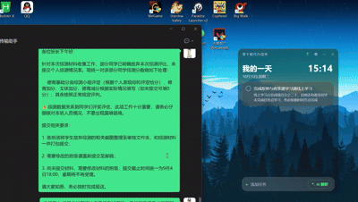
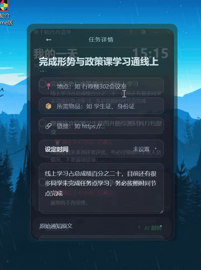
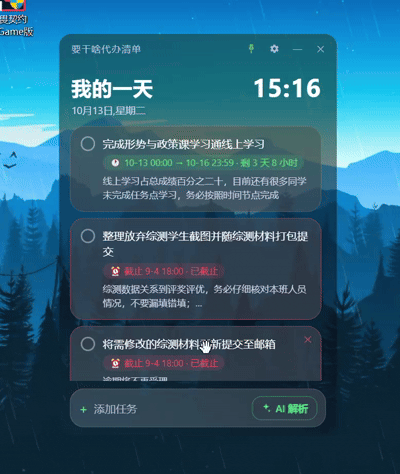

# WhatToDo

你是否也因为群里又臭又长的通知而苦恼过？

群消息一条接一条，一句"@全体成员"后面跟着一大段话：考试时间、截止日期、携带材料、评分占比、网址链接……从头看到尾要花好几分钟，看完心里还是没底——我到底要做几件事？什么时候截止？要带什么？要不要回复？

这个软件，就是为了解决这件事而生的。

把那段让你头疼的通知整段粘进来，AI 帮你拆成清清楚楚的待办清单：做什么、几点截止、在哪、要带什么、附什么链接，一眼全部看懂。不会再漏掉任何一件小事，也不用再对着通知反复琢磨。

剩下的时间，去做你真正该做的事。

## 🎬 功能演示

**📌 窗口置顶** —— 一键把清单钉在桌面最上层，随时瞄一眼



**🤖 解析复杂通知** —— 再长的通知，AI 也给你拆得明明白白



**⏰ 时间安排** —— 日历设定开始/截止时间，倒计时一目了然



**🎯 重要程度一目了然** —— 截止状态、倒计时、备注清清楚楚



## ✨ 功能

- **AI 解析**：粘贴任意长文本 → 大模型自动提取任务/截止时间/地点/物品/链接 → 预览可修改 → 确认进列表
- **待办列表**：勾选完成、右上角悬停删除、长按拖拽排序（自动保存）
- **任务详情**：结构化展示地点/物品/链接，原始通知原文可编辑，日历设定开始/截止时间（单点=当天开始，两点=时间段）
- **样式主题**：深色 / 浅色 / 玻璃半透明（可调透明度，透出桌面）
- **窗口置顶**：一键钉在桌面最上层
- **开机自启**：设置里可开关
- **24 小时制时钟**：标题栏实时显示

## 🚀 快速开始

需要 Node.js 18+。

```bash
npm install
npm start          # 构建并启动
```

使用前先配置 AI 接口：点右上角 ⚙ 设置 → AI 解析 → 选择服务商（豆包 / DeepSeek / Kimi / 千问）→ 填入 API Key → 选模型。

> 无 API Key 时无法解析（会提示去设置）。本项目**不内置任何模型服务**，所有请求由你配置的服务商处理。

## 📦 打包

```bash
npm run build      # 构建前端到 dist/
```

绿色版打包（Windows）：将 `main.js / preload.js / package.json / lib / dist` 放入 Electron 解压目录的 `resources/app/` 即可。

## 🗂 目录结构

```
├── main.js              # Electron 主进程：窗口、本地存储、IPC、置顶、开机自启
├── preload.js           # 安全桥接（contextBridge）
├── lib/ai.js            # AI 解析：多服务商调用 + 时间/年份修正
├── src/
│   ├── App.vue          # 主界面：列表 + 添加栏 + 时间
│   ├── theme.js         # 主题应用（深色/浅色/玻璃）
│   └── components/
│       ├── TodoItem.vue      # 列表单条待办
│       ├── AiParsePanel.vue  # AI 解析面板
│       ├── DetailModal.vue   # 任务详情页
│       └── SettingsModal.vue # 设置（主题/AI/作者）
└── style.css           # 主题变量 + 样式
```

## 🔒 数据隐私

- 任务列表、API Key、样式配置**全部保存在你的本地电脑**（应用数据目录），不会上传任何服务器
- 本项目不收集、不中转你的任何文本；AI 解析请求仅由你填写的模型服务商处理
- 删除软件数据：关闭软件后删除 `%APPDATA%/todo-ai-app`（Windows）

## 🧠 技术栈

Electron 31 · Vue 3.4 · Vite 5 · 纯前端本地持久化（JSON）

## 📄 许可证

MIT

---

Made by penguin 🐧

- 小红书：26790182778
- GitHub：https://github.com/KuzeMAX117/Text2Todo
- 邮箱：1563215141@qq.com（有任何更好的建议，或者想和我做朋友，欢迎来信）
